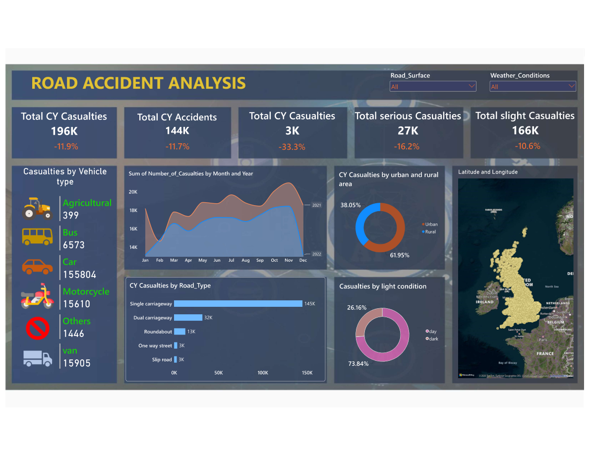
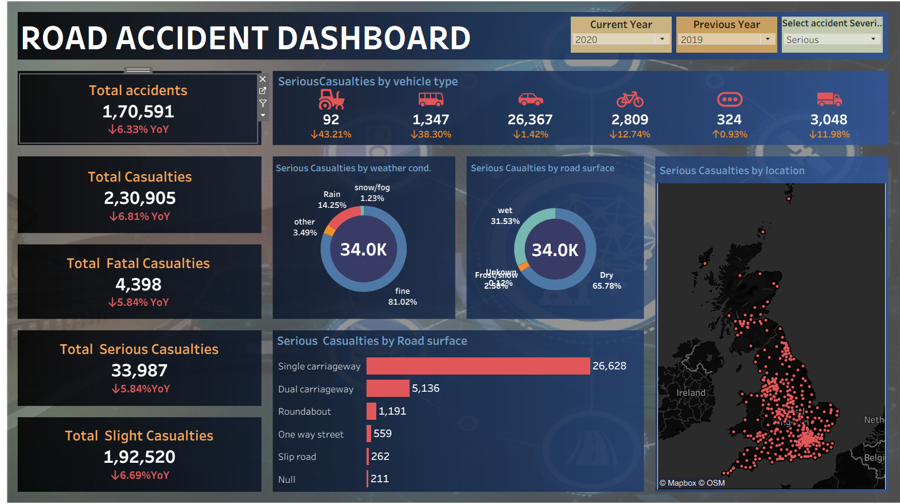

# Road Accident Analysis Dashboard

An end-to-end road accident analytics project using **Power BI, Tableau, and CSV data** to explore accident casualties, severity, vehicle types, road conditions, weather, lighting, geography, and year-over-year changes.

## Project Overview

This project contains two dashboard views built for the same road-accident analysis:
- **Power BI dashboard** — KPI cards, year-over-year comparisons, vehicle-type analysis, weather and road-surface breakdowns, road-type comparisons, and a geographic view.
- **Tableau dashboard** — year and accident-severity filters, casualty KPIs, serious casualties by vehicle type, weather conditions, road surface, road type, and location.

The supplied dataset contains **660,679 records and 14 columns**, covering **1 January 2019 to 31 December 2022**. The dataset includes accident severity, date, casualty and vehicle counts, lighting, district, coordinates, road surface/type, urban/rural area, weather, and vehicle type.

## Dashboards

### Power BI


### Tableau



## Key Questions

- How do accidents and casualties change between years?
- How are casualties distributed by severity?
- Which vehicle types account for the largest number of casualties?
- How do weather, road-surface, road-type, and lighting conditions relate to casualty counts?
- How do casualty counts differ between urban and rural areas?
- Where are recorded accidents geographically concentrated?

## Dataset

**File:** `accident data.csv`

Important columns:
- `Index` — accident record identifier
- `Accident_Severity` — Fatal, Serious, or Slight
- `Accident Date` — date of the accident
- `Number_of_Casualties` — casualties recorded for the accident
- `Number_of_Vehicles` — vehicles involved
- `Vehicle_Type` — vehicle category
- `Road_Type`, `Road_Surface_Conditions`, `Weather_Conditions`, `Light_Conditions`
- `Urban_or_Rural_Area`, `District Area`
- `Latitude`, `Longitude` — geographic coordinates


## Tools Used

- Microsoft Power BI
- Tableau
- CSV data
- Data visualization and dashboard filtering

Only list Python, SQL, or other tools here if you actually used them in this project.

## Repository Structure

```text
road-accident-analysis-dashboard/
├── README.md
├── accident data.csv              # Optional; include only if size and sharing rights allow
├── power-bi/
│   └── road-accident-dashboard.pbix
├── tableau/
│   └── road-accident-dashboard.twbx
└── images/
    ├── power-bi-dashboard.png
    └── tableau-dashboard.png
```

Use your actual exported filenames and extensions. A packaged Tableau workbook (`.twbx`) is usually more portable than a `.twb` file alone because it can include supporting files.

## Notes on Interpretation

- Dashboard KPI values depend on the selected year, severity, filters, and measure definitions.
- The screenshots show different views and figures; do not compare their totals directly unless the filters, year selections, and calculations are aligned.
- The dataset has missing values in some road, weather, and geographic fields. Missing values should be handled consistently before interpreting category-level results.
- These dashboards are descriptive. They show patterns and associations, not proof that a particular condition caused an accident.

## How to Explore

1. Open the Power BI `.pbix` file in Power BI Desktop.
2. Open the Tableau packaged workbook `.twbx` in Tableau Desktop, or use the Tableau Public link if you published it.
3. Try changing year, accident severity, road surface, and weather filters.
4. Compare the same year and equivalent measures across both tools.

## Project Goal

To turn road-accident records into interactive visuals that make trends and differences across severity, vehicle type, road conditions, time, and geography easier to explore.
